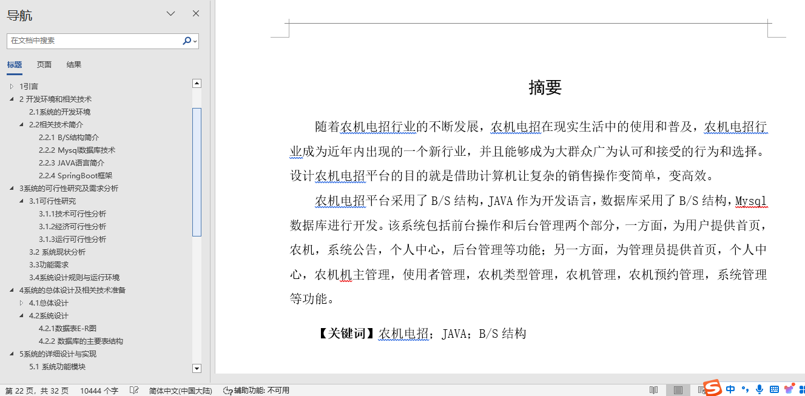
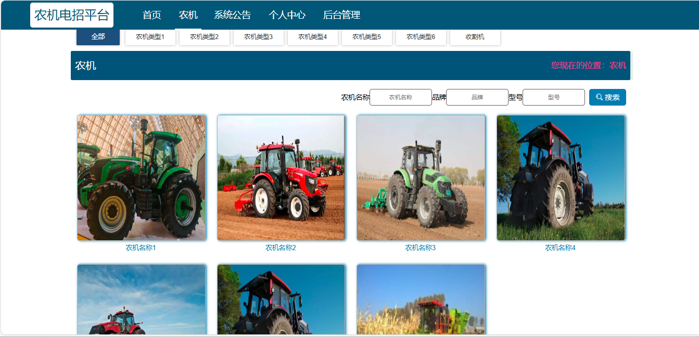
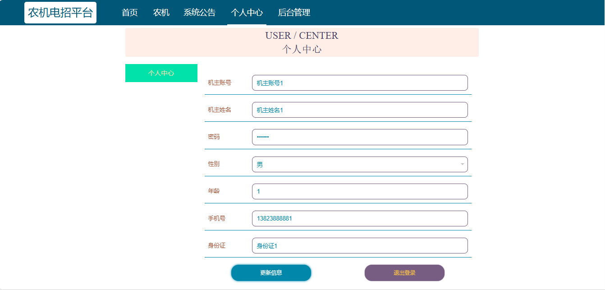
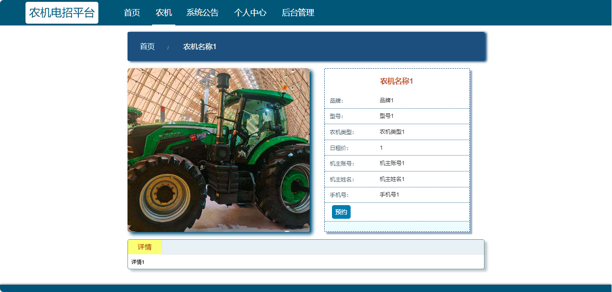
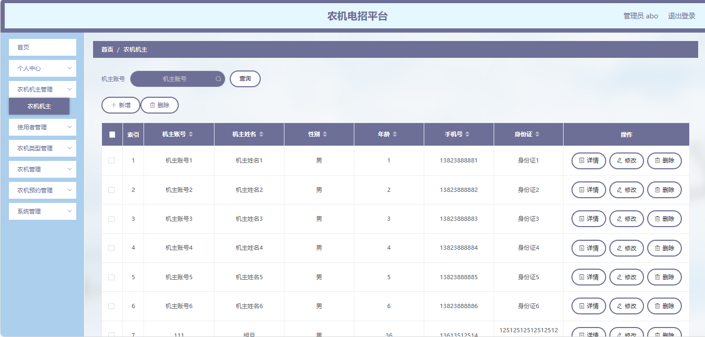
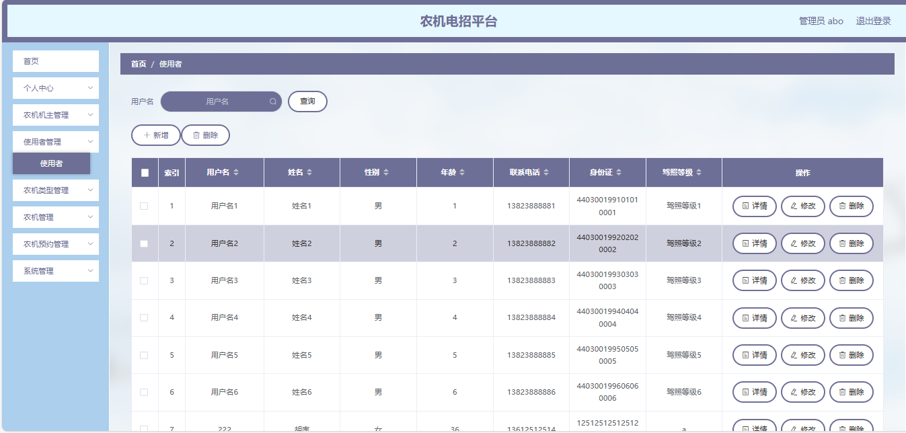
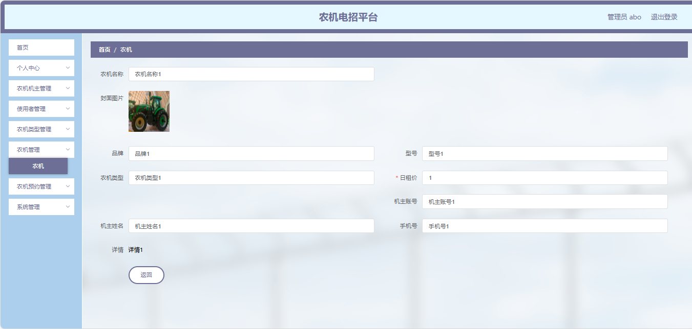
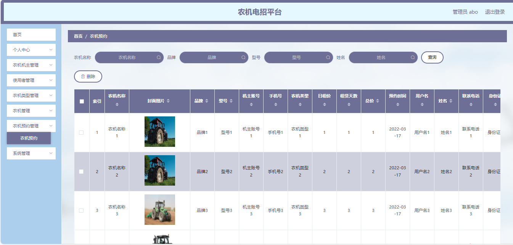

## 基于springboot的农机电招平台(程序+报告)

###  获取完整源码和sql数据库文件（完全免费）:  微信: littlepinia88 qq：1104515926
###  所有项目以及源代码本人均调试运行无问题 可支持远程安装部署调试、定制修改、代码讲解

## 项目介绍

本项目是一个基于 Spring Boot 的农机招租预约平台，面向农村地区农机共享租赁的业务场景：农机机主发布自己的农机档案并接受预约，使用者在线浏览农机、提交租赁预约，后台统一审核运营，采用「用户端静态页面 + 后台 Vue 管理端 + 后端 REST 接口」的前后端分离结构，打通了农机上架、在线预约、租期计价、订单审核与支付状态流转的完整租赁业务闭环。后端基于 Spring Boot + MyBatis-Plus 提供 JSON 接口，后台管理端使用 Vue2 + ElementUI 单页应用，用户端为 Layui + ElementUI 静态 HTML 页面，属于典型的 Java Web 前后端分离项目，可直接作为课程设计、毕业设计或 Spring Boot 入门实践案例。

### 系统角色
- **管理员**：登录后台管理端，维护使用者、农机机主、农机类型、农机档案、农机预约与系统公告。
- **农机机主**：注册并登录用户端，发布与维护自己的农机档案，查看收到的预约记录。
- **使用者（租机方）**：注册并登录用户端，浏览农机、按类型筛选、在线提交租赁预约。
- **权限控制**：由 `AuthorizationInterceptor` 基于 Token 统一拦截，请求头携带 `Token`，登录成功后签发令牌并写入 `token` 表；标注 `@IgnoreAuth` 的登录、注册、公开列表与详情接口放行，其余接口需携带有效 Token。

### 用户端功能
1. **注册与登录**：使用者与农机机主分别注册，使用者登记姓名、性别、年龄、联系电话、身份证、驾照等级；机主登记机主姓名、性别、年龄、手机号、身份证；登录成功后后端签发 Token，支持退出与密码重置。
2. **农机浏览**：分页展示农机列表（农机名称、封面图片、品牌、型号、农机类型、日租金、机主联系方式），支持按农机类型筛选，详情页查看图文详情。
3. **农机预约**：使用者选择农机后填写租赁天数、预约时间、工作地点、备注提交预约，预约单记录租赁天数 `zulintianshu` 与总价 `zongjia`（该总价由提交预约时填入，后端未做租金×天数的自动核算）；预约单带审核状态 `sfsh`、审核回复 `shhf` 与支付状态 `ispay`。
4. **机主农机管理**：农机机主可新增、编辑、下架本人发布的农机档案（名称、品牌、型号、日租金、图片、详情）。
5. **公告浏览**：查看后台发布的系统公告列表与详情。

### 管理端功能
1. **管理员登录 / 注销**：管理员账号登录后台，登录态基于 Token 校验，支持退出。
2. **使用者与机主管理**：对使用者（`shiyongzhe`）与农机机主（`nongjijizhu`）分别进行分页查询、新增、编辑与删除。
3. **农机类型管理**：维护农机类型字典（`nongjileixing`），供农机档案下拉选择。
4. **农机管理**：分页维护农机档案，支持新增、编辑、删除，登记农机名称、封面、品牌、型号、所属类型、日租金与详情。
5. **农机预约管理**：查看全部预约单，按租赁天数与总价核对，执行审核（`sfsh`）、填写审核回复（`shhf`）并维护支付状态（`ispay`）。
6. **公告管理**：发布与维护系统公告（标题、简介、封面、内容）。

### 技术栈
- **后端框架**：Spring Boot 2.2.2.RELEASE、Spring MVC，JDK 1.8
- **数据访问**：MyBatis-Plus 2.3（mybatis-spring-boot-starter 2.1.1），MySQL 数据库，Mapper XML 位于 `classpath*:mapper/*.xml`
- **前端**：管理端 Vue 2.6 + Element-UI 2.13 + Vue Router + Axios（Vue CLI 4 构建）；用户端为 Layui + ElementUI 静态 HTML 页面
- **工程能力**：统一 `R` 响应模型、`AuthorizationInterceptor` Token 鉴权、`@IgnoreAuth` 注解放行、FastJSON、Hutool、Commons-IO 文件上传
- **构建运行**：Maven 构建，`spring-boot-maven-plugin` 打包；前端工程位于 `src/main/resources/admin/admin`，`npm run serve` 开发、`npm run build` 打包进 `dist`

### 核心数据表
- `shiyongzhe` 使用者表：用户名 `yonghuming`、姓名 `xingming`、密码 `mima`、性别、年龄、联系电话、身份证、驾照等级 `jiazhaodengji`
- `nongjijizhu` 农机机主表：机主账号 `jizhuzhanghao`、机主姓名 `jizhuxingming`、密码、性别、年龄、手机号 `shoujihao`、身份证
- `nongjileixing` 农机类型表：类型名称 `nongjileixing`
- `nongji` 农机表：农机名称 `nongjimingcheng`、封面图片 `fengmiantupian`、品牌 `pinpai`、型号 `xinghao`、农机类型、日租金 `rizujia`、机主账号/姓名、手机号、详情 `xiangqing`
- `nongjiyuyue` 农机预约表：农机名称、日租金、租赁天数 `zulintianshu`、总价 `zongjia`、预约时间 `yuyueshijian`、用户名、驾照等级、工作地点 `gongzuodidian`、备注、审核状态 `sfsh`、审核回复 `shhf`、支付状态 `ispay`、下单用户 `userid`
- `news` 系统公告表：`title`、`introduction`、`picture`、`content`

### 工程结构
```
A014springbootr910z
├── src/main/java/com
│   ├── controller/     REST 控制器（使用者、机主、农机、类型、预约、公告等）
│   ├── service/        业务接口与 impl 实现
│   ├── dao/            MyBatis-Plus Mapper 接口
│   ├── entity/         Entity/Model/View/VO 四层实体
│   ├── config/         InterceptorConfig、MybatisPlusConfig 等配置
│   ├── interceptor/    AuthorizationInterceptor Token 鉴权
│   ├── annotation/     IgnoreAuth 免登录注解
│   └── utils/          R、分页、文件、Token 等工具类
├── src/main/resources
│   ├── mapper/         MyBatis Mapper XML
│   ├── admin/admin/    后台 Vue2 + ElementUI 工程（src/views/modules + dist 打包产物）
│   ├── front/front/    用户端静态 HTML 页面（pages/ + layui + elementui）
│   ├── static/upload/  本地上传文件目录
│   └── application.yml  端口、上下文路径、数据源、MyBatis-Plus 配置
├── screenshot/         运行截图
└── pom.xml
```

### 访问入口
- 后台管理端（打包后）：`http://localhost:8080/springbootr910z/admin/admin/dist/index.html`
- 用户端首页：`http://localhost:8080/springbootr910z/front/front/index.html`
- 后台前端开发调试：`http://localhost:8081`（Vue CLI dev server，代理 `/springbootr910z` 到 8080）
- 后端接口前缀：`http://localhost:8080/springbootr910z`

### 补充说明
- 端口、上下文路径（`/springbootr910z`）与数据库连接均在 `src/main/resources/application.yml` 中配置（默认库 `a014_springbootr910z`，root/123456），首次运行需按本机 MySQL 调整账号密码并先导入 SQL 脚本建表。
- 密码以明文形式入库，登录后仅以 Token 标识身份，未引入权限框架；预约支付 `ispay` 仅为状态标记，未接入真实支付渠道。
- 上传图片保存在本地磁盘 `static/upload/`，部署时需保证目录可写。
- 预约单总价 `zongjia` 为随预约单提交时带入的字段，后端未按「日租金 × 租赁天数」自动核算，二次开发时如需自动计价需自行补充计算逻辑。

## 运行环境
- JDK版本：JDK1.8及以上
- 开发工具：IDEA、Ecplise、Myecplise都可以
- 数据库: MySQL5.7及以上
- Node：14.14.0及以上

## 运行截图
















